<p align="center">
  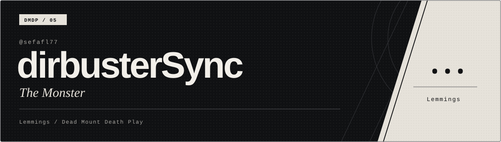
</p>

<h1 align="center">dirbusterSync</h1>

<p align="center">
  <strong>Security research · Software engineering · AI & data · Game development</strong>
</p>

<p align="center">
  Sefa · @sefafl77 on GitHub · dirbusterSync on Hack The Box.<br>
  I build useful software, explore security in authorized labs, and turn what I learn into tools, games, and practical notes.
</p>

<p align="center">
  <a href="https://sefafl.online"></a>
  <a href="https://pentest.sefafl.online"></a>
  
</p>

---

## What I'm into

| Area | What I work on |
| --- | --- |
| **Security research** | Authorized HTB and lab work, web security, write-ups, and educational proof-of-concept research. |
| **Software & web** | Useful web apps, portfolio experiences, and small tools that make workflows smoother. |
| **AI & market data** | An Indonesian stock-market analysis dashboard built for research and decision support. |
| **Game development** | Gameplay ideas, prototypes, and Roblox experiences using Luau. |
| **Developer tooling** | Automation and experiments that connect practical engineering with AI-assisted workflows. |

## SIEM / EDR / XDR

Security platforms of interest — detection, endpoint telemetry, and incident response.

<p align="center">
  <a href="https://www.splunk.com/en_us/products/enterprise-security.html">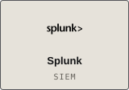</a>
  <a href="https://www.elastic.co/security">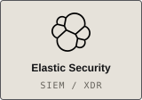</a>
  <a href="https://wazuh.com/platform/overview/">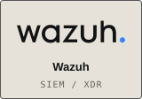</a>
</p>
<p align="center">
  <a href="https://www.datadoghq.com/product/cloud-siem/">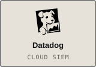</a>
  <a href="https://www.opentext.com/products/enterprise-security-manager">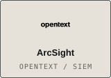</a>
  <a href="https://learn.microsoft.com/en-us/azure/sentinel/sentinel-overview">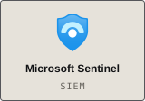</a>
</p>
<p align="center">
  <a href="https://www.crowdstrike.com/en-us/platform/endpoint-security/falcon-insight-xdr/">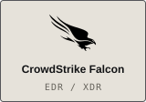</a>
  <a href="https://www.sentinelone.com/platform/singularity-xdr-protection/">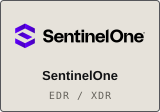</a>
  <a href="https://www.trendmicro.com/en_us/business/products/one-platform.html">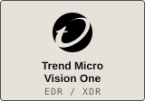</a>
</p>

## Selected work

- **[PenSefter](https://pentest.sefafl.online)** — my Hack The Box write-ups: the clues, reasoning, and steps behind each attack path.
- **[Personal portfolio](https://sefafl.online)** — a closer look at my software, security, and game development work.
- **[CVE-2025-27591 PoC](https://github.com/sefafl77/CVE-2025-27591-PoC)** — an educational security research implementation. Use only in an authorized test environment.
- **AI and market data** — building an Indonesian stock-market analysis dashboard for research and decision support.
- **Game prototypes** — experimenting with gameplay systems and interactive experiences.

## Hack The Box / dirbusterSync

**Professional rank · Level 46**<br>
Season 12: **Silver Tier · #109 · 175 points · 6/18 flags**

<p align="center">
  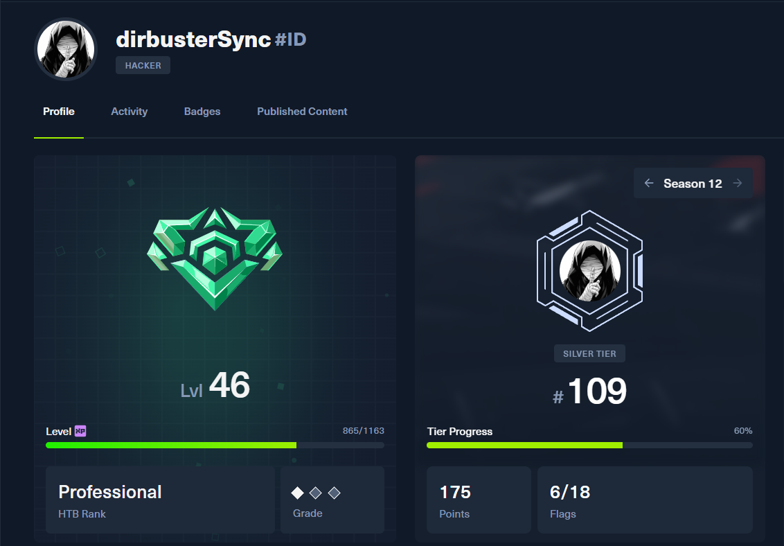
</p>

<p align="center"><sub>Profile snapshot shared on 16 October 2026.</sub></p>

## Tools I use

<p>
  
  
  
  
  
  
  
</p>

## How I build

```text
Explore the problem  →  build a small, useful solution  →  test it in the right environment  →  write down what I learn
```

I value hands-on learning, clear notes, and responsible security work. Most of all, I enjoy connecting disciplines that usually sit in separate boxes.

<p align="center">
  <em>Curious by default. Careful with impact. Always building.</em>
</p>
